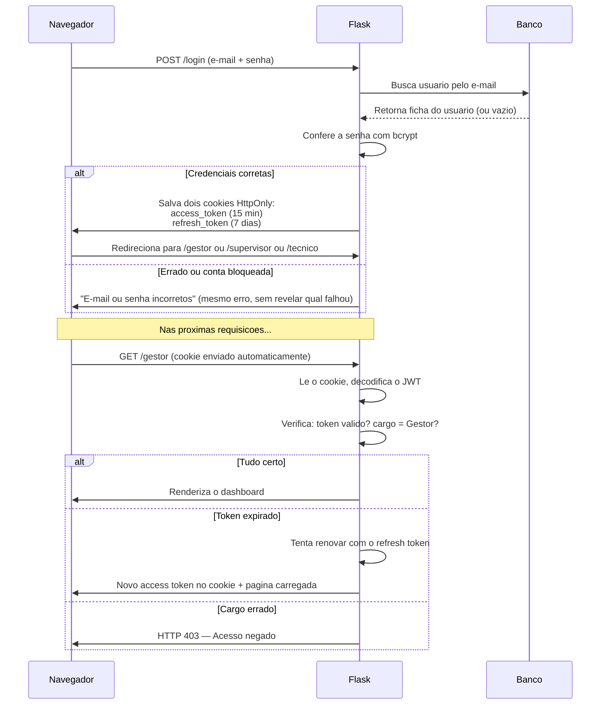

# Como funciona o login no ATALAIA 4.0

## O fluxo em palavras simples

Quando você entra no sistema, o servidor precisa responder duas perguntas:
1. **Quem é você?** — confirmado pela senha (autenticação)
2. **O que você pode ver?** — definido pelo seu cargo (autorização)

---

## Passo a passo: do clique ao dashboard



---

## O que é o JWT (a "pulseira de entrada")

Pense no JWT como uma pulseira de show: ela prova que você pagou o ingresso e diz qual área você pode entrar. O servidor não precisa consultar o banco a cada clique — ele só lê a pulseira.

- **access_token** — válido por 15 minutos; enviado em todo pedido
- **refresh_token** — válido por 7 dias; usado só para gerar um novo access_token quando ele expira
- Ambos ficam em **cookies HttpOnly**: o JavaScript da página não consegue lê-los, o que protege contra ataques XSS

---

## Por que dois tokens?

| Token | Duração | Para que serve |
|---|---|---|
| access_token | 15 min | Autoriza cada requisição |
| refresh_token | 7 dias | Renova o access_token sem pedir login |

Se o access_token for roubado, ele expira em 15 minutos. O refresh_token nunca sai do cookie seguro.

---

## Proteção CSRF

Sem proteção, uma página maliciosa poderia fazer seu navegador enviar requisições ao ATALAIA sem você saber. Para evitar isso, usamos o método **double-submit**:

1. O servidor grava um token CSRF num cookie que o JavaScript **pode** ler
2. Todo formulário POST inclui esse token num campo oculto
3. O servidor confere: o token do cookie bate com o do formulário? Se não, rejeita

---

## O que fica gravado no JWT

Apenas o ID do usuário e o cargo — nenhum dado sensível como CPF ou e-mail.

```json
{
  "sub": "42",
  "cargo": "Supervisor",
  "exp": 1748000000
}
```
